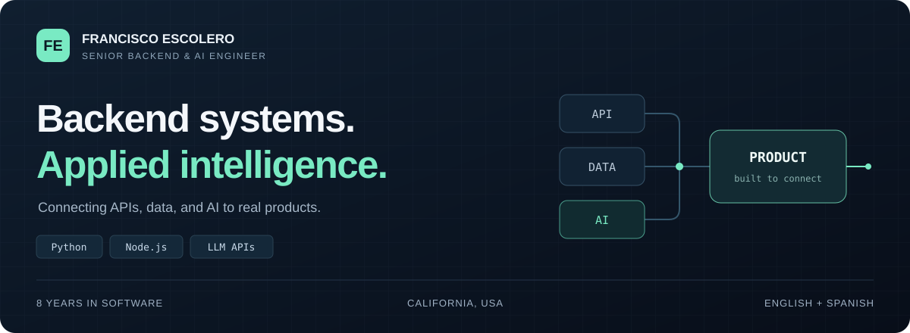



# Francisco Escolero

**Senior Backend & AI Engineer · Python · Node.js · Applied AI**

California, USA &nbsp; / &nbsp; 8 years in software &nbsp; / &nbsp; English + Spanish

**[Let's talk →](mailto:fescolero88@gmail.com)** &nbsp; · &nbsp; [LinkedIn](https://www.linkedin.com/in/francisco-escolero-6b3036424/) &nbsp; · &nbsp; [Explore my repositories](https://github.com/fescolero88?tab=repositories)

I build the systems behind the experience: the API serving the app, the pipeline making supplier data usable, and the orchestration turning an AI response into a product feature.

My work connects **backend engineering, applied AI, and business integrations** across travel, logistics, telehealth, and commerce. At **DigitalHeroes**, I build LLM-powered services and data pipelines while guiding architecture, code review, and releases.

## What I bring to a team

| Backend engineering | Applied AI | Data and integrations |
| :--- | :--- | :--- |
| Python and Node.js services, API architecture, authentication, caching, and background jobs. | LLM orchestration, prompt design, content generation, output validation, and provider fallbacks. | ETL, supplier feeds, record matching, webhooks, and commerce and logistics APIs. |

## Engineering in practice

### 01 / Turning travel data into usable intelligence

**DigitalHeroes · Senior Backend and AI Engineer**

Built LLM services for hotel and destination classification, enrichment, and content generation. Designed Python ETL pipelines to normalize supplier feeds, deduplicate records, and match data across sources. Own REST API design and maintenance alongside technical leadership.

`Python` `Node.js` `LLM APIs` `PostgreSQL` `Next.js`

### 02 / Making carrier integrations resilient

**FamesTransport · Backend Developer**

Built multi-carrier shipping and tracking features with normalized events and automated customer notifications. Added retries, deduplication, and failure recovery around unreliable third-party APIs, and connected merchant systems through REST APIs and webhooks.

`Laravel` `PHP` `MySQL` `REST APIs` `Webhooks`

### 03 / Connecting patients and clinicians

**Treat at Home · Contract project**

Built the Django backend for appointments, patient records, and role-based access. Integrated Twilio video consultations and SMS for a telehealth platform released on iOS and Android.

`Python` `Django REST Framework` `Twilio` `Flutter`

### 04 / Orchestrating AI content generation

**Crayo.ai · Contract project**

Contributed backend services and third-party AI orchestration for text-to-video content generation, including asynchronous processing for long-running generation jobs.

`Node.js` `LLM APIs` `Asynchronous jobs` `Cloud infrastructure`

**Also in commerce:** Custom storefronts and backend integrations for Alb-Filter, Mushroomrise, Teddy Howler, BestCarwash, and Falkenwald using **Node.js, Vendure, GraphQL, and Qwik.js**. Work covered inventory synchronization, checkout, fulfillment, and marketing integrations.

## Tools I work with

| Layer | Toolkit |
| :--- | :--- |
| **Backend** | Python · Node.js · TypeScript · Django / DRF · Express · Laravel |
| **AI and automation** | OpenAI APIs · Anthropic APIs · Prompt engineering · Content pipelines |
| **Data** | PostgreSQL · MySQL · Redis · Firebase / Firestore · ETL |
| **Infrastructure** | AWS · Docker · GitHub Actions · CI/CD · Linux · Vercel |
| **Integrations** | Twilio · RevenueCat · Shopify · Vendure · Payment and carrier APIs |
| **Web and mobile** | React · Next.js · Vue.js · Flutter · Tailwind CSS |

## How I approach the work

**Validate the output. Plan for failure. Make the next change easier.**

Those principles show up in output validation for AI services, recovery logic for external APIs, clear service contracts, and code reviews that help a team maintain what it ships.

## My path

| When | Where | Role |
| :--- | :--- | :--- |
| 2023–present | DigitalHeroes | Senior Backend and AI Engineer |
| 2022–2023 | FamesTransport | Backend Developer |
| 2021–2022 | Facebook | Intern |

**B.Sc. in Computer Science · Arizona State University · 2018–2021**

## Build something useful

Need a backend for your product, an AI integration, or a pipeline that brings your data together? Let's discuss the problem and what it takes to deliver.

**[fescolero88@gmail.com](mailto:fescolero88@gmail.com)** &nbsp; / &nbsp; **[Connect on LinkedIn →](https://www.linkedin.com/in/francisco-escolero-6b3036424/)**
